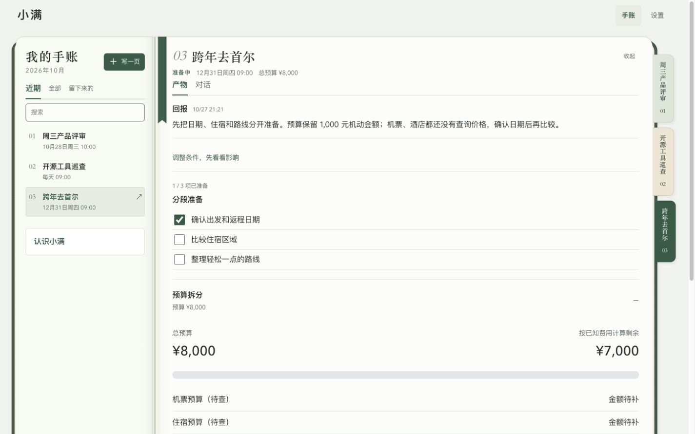
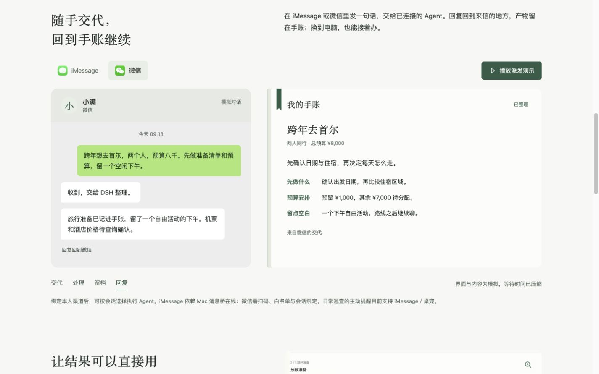

# Morlet

把事情交代给你自己的 Agent，过程、产物和下一次跟进，留在同一篇。

Morlet 运行在本机或自管服务器，连接已有的 DSH、Codex 或 WorkBuddy。你可以在网页、微信或 iMessage 里交代任务，回到手账查看结果、补充要求，或让它按日程继续跟进。

[当前源码](https://github.com/Lazarus893/morlet) · [已发布安装包](https://github.com/Lazarus893/morlet/releases) · [旧版产品介绍 HTML](https://github.com/Lazarus893/morlet/releases/latest/download/xiaoman-intro.html) · [安装说明](docs/skill-bundle.md)

本文描述当前源码。Release 安装包和介绍页以对应版本的更新记录为准，可能尚未包含下述最新能力；更新源码不会自动生成新版安装包。已有发布资产仍使用 `xiaoman-skills.zip`、`xiaoman-intro.html` 等文件名。



*2026 年 10 月 27 日旧版界面，使用演示数据。HTML 介绍内含更多页面截图和多端派发模拟，可下载后在浏览器打开。*

## 能帮你做什么

- **一件事，一篇手账。** 目录按事务、巡查、资料分组；「产物」回看结果、文件和 Widget，「对话」补充要求、继续处理。同源时序资料默认显示最新一期，历史仍可回看。
- **把结果变成可继续用的 Widget。** 按任务呈现准备步骤、候选比较、预算、路线等 20 类组件；保留必要选择和确认，调整交代走聊天。鼠标拖动或键盘排序会自动保存。
- **从常用消息入口派发。** 本人验证后的微信、iMessage 与 Web 共用全员群和对应 Bot 的固定私聊；Mori 负责收件与分派，也可用 `@` 指定成员。结果只回复来信渠道。
- **读懂事情目前怎样。** 情况说明直接呈现结论、变化和需要决定的事；部分结果、未读到的材料和失败保持可见。手账来源与回报可定位到各自的原消息。
- **关掉窗口，事情继续。** 指定检查时间、资料范围和回报条件，后台按日程执行。没有变化保持安静，读取失败明确显示受阻。
- **授权随时可查、可收回。** 设置页查看服务、设备、消息渠道与 Agent 状态；持续任务按各自授权范围读取，撤权后停止使用失效来源。

Mori 是默认总管 Bot，负责收件与分派。主导航为「手账 / 聊天 / 设置」。手账保存事务和产物，聊天保留一个全员群和每位 Bot 的固定私聊，设置分为连接与 Bot 管理。

- **按职责协作。** 默认 Mori 总管、阿探（调研）、小序（规划）、阿造（制作）。在对应 Bot 的私聊里交代，或在全员群用 `@research @maker` 协作；成员可在当前事项内互相询问，答复后接着办。独立发言可以各自完成，需要综合结论时再交回总管汇总。执行并发受连接端容量限制。
- **自己创建 Bot。** 设置 → Bot → 新建，填写名字和职责、选择头像。新建后自动加入全员群，默认使用 DSH；执行方式可改为已连接的 Codex/WorkBuddy。初始总管沿用实例已配置的对话连接，其他 Bot 不会静默改用别的执行器。
- **各自负责 Routine。** 在对应 Bot 的聊天里交代日常巡查；该 Bot 页面可查看所属巡查。停用 Bot 会暂停它的巡查并取消在途任务，历史保留。

每位 Bot 只有一个固定私聊入口，全员群独立，不需要管理或新建会话。连续 24 小时没有用户消息后，下次发送会刷新模型上下文；历史消息和手账产物仍可回看，正在执行的任务保留原上下文。只有显式验证属于本人的消息路线才共享对应上下文；未验证账号和其他联系人继续隔离，群聊与私聊也不混用上下文。

IM 收件不再发送固定确认套话。当前微信接口没有原生 reaction；本机 imsg 的普通 Tapback 无法精确定位消息，因此这两个入口先静默接单，仍保留结果、失败和审批消息。详见[Bot 实施计划与边界](docs/bots-plan.md)。

## 多端任务派发



*模拟对话与产物，等待时间已压缩；不代表图中任务已真实执行。*

在设置中完成渠道连接，并显式验证为本人后，微信和 iMessage 按同一规则派发：

| 消息 | 在 Web 中的位置 | 谁处理 |
| --- | --- | --- |
| 不带 `@` | 全员群 | Mori 接手并按需要分派 |
| 只 `@` 一位 Bot | 该 Bot 的固定私聊 | 被指定的 Bot |
| `@` 多位 Bot | 全员群 | 被指定的成员协作 |

例如，在微信发“把指定材料整理成会前准备”，之后可以在 Web 全员群继续；发 `@research 核对这份资料`，则进入阿探的固定私聊。普通聊天不自动变成手账，需要保存的产物才进入对应事项。回复回到来信入口，不向其他渠道广播。

历史消息保留可核实的 Web、微信或 iMessage 来源；展示顺序使用可信发送时间，缺失时使用接收时间。重复入站不会重复派发；旧链接继续指向原消息。渠道与执行方式分别配置，微信不固定绑定某一种 Agent。

微信需要本人扫码、白名单确认与会话绑定；iMessage 需要专用收发身份、Mac 系统授权及在线的消息桥。详见[多入口接入](docs/getting-connected.md)与 [iMessage 接入](docs/imessage-setup.md)。

## 开始使用

当前是 **单主人工作区**。每位用户部署独立实例，连接自己的 Agent、账号与设备；不把现有个人实例当成多用户共享服务。

### 安装已发布版本

1. 下载 Release 中的 [`xiaoman-skills.zip`](https://github.com/Lazarus893/morlet/releases/latest/download/xiaoman-skills.zip)。
2. 解压后，将 `skills/xiaoman-setup/` 交给已登录的 Codex 或 WorkBuddy，要求它阅读 `SKILL.md`，在你选择的新目录安装。
3. 按该 Release 的安装说明完成连接、本人扫码和第一件任务验证。旧安装包的界面可能与当前源码不同。

技能包包含框架载荷，使用现有 CLI 登录；不需要为 Codex/WorkBuddy 对话另配模型 key。账号登录、系统权限和微信扫码由本人完成。[安装、恢复与升级](docs/skill-bundle.md)

### 从源码安装

需要 **Node.js 22.19+、npm、Python 3.12+**。先安装并登录所选 Agent CLI；主要开发与验收环境为 macOS，Linux 支持范围见下表。

```bash
git clone https://github.com/Lazarus893/morlet.git
cd morlet
cp .env.example .env
./scripts/pa.sh init --agent codex --owner "你的称呼" --device none
./scripts/pa.sh setup
./scripts/pa.sh doctor
./scripts/pa.sh owner
./scripts/pa.sh web
```

设置主人密码后，打开 [本机手账](http://127.0.0.1:3083/#journal)，在「设置」检查执行 Agent 与所需渠道，再到「聊天 → Mori」交代第一件事。空手账的「找 Mori」也会带入一份可编辑草稿，发送前不会创建任务。首次未配对白名单时，`doctor` 会列出缺项并返回退出码 2；它只做本机检查，不调用模型或发送消息。

- **Codex**：复用已登录的 Codex CLI；空的 `agent.command` 从 PATH 查找 `codex`。
- **WorkBuddy**：将初始化参数改为 `--agent workbuddy`；桌面登录与独立 CLI 登录需分别核对。
- **DSH**：改为 `--agent dsh`，并在本机 `.env` 配置自己的 `DEEPSEEK_API_KEY`。

微信通道宿主使用锁定版本的 DSH；总管沿用初始化时配置的执行连接，其他 Bot 在设置中分别配置。手机视觉模型单独配置，基础手账使用不要求接手机。

## 交代一件有用的事

> 明天上午十点有产品评审。读取我指定的两份材料，整理关键进展、风险和三个需要拍板的问题，保存成一页会前准备。

材料与读取范围由你提供或授权。回到同一篇，可以继续交代“先展开第二个风险”，也可以查看已经保存的产物。

需要持续跟进时，可以交代：

> 每天上午九点检查我选定的这个 GitHub 仓库；出现新的正式版本时，说明对我的影响，更新这篇手账。先只记在手账里，月底结束。

创建前核对仓库、时间、范围与结束日期。每项跟进可以暂停、结束或收回来源授权。后台服务与执行端需要保持在线；关闭浏览器不影响后台，电脑关机或离线会影响执行。[日常巡查与节点提醒](docs/routines.md)

## 接入范围

| 能力 | 当前支持与条件 |
| --- | --- |
| 执行 Agent | DSH 原生会话、Codex CLI、WorkBuddy 内置 CodeBuddy CLI；续聊、审批、取消与交接按适配器能力执行 |
| 消息渠道 | Web、微信 iLink、指定私聊的 iMessage，以及按实例配置的桌宠；发送、送达与已读分别记录 |
| Google | Gmail、Calendar、Drive、Docs、Sheets、Contacts 的受控读取；需对应账号授权与可用 CLI |
| GitHub / X | GitHub 仓库、PR、通知、发布与提交；X 读取取决于账号授权和 API 额度 |
| 本地文件 | 已授权目录内检索；对话可选单份 PDF/DOCX/文字资料，供本篇任务及显式续办读取，24 小时后需重新选择。10 MiB、2 万字符、PDF 100 页；扫描件/OCR 暂不支持 |
| 私有 Nango | 支持服务的 OAuth 与只读代理；新增 App 仍需适配，不代表全部第三方服务已接通 |
| DSH Remote | 已授权设备的原生会话查看、继续、停止与单次审批；与手账执行链路分别管理 |
| Android / iPhone | 可选 ADB 或 WebDriverAgent/XCTest 链路；本人完成设备连接与系统授权 |

DSH 可执行受限公开网页巡查；Codex 后台巡查目前限受控资料源，WorkBuddy 尚不支持这类后台巡查。普通对话能力与后台巡查能力分别核对。

巡查默认只写手账；当前可显式选择 iMessage／桌宠接收节点提醒，微信不属于这类巡查提醒渠道。读取失败、授权失效与投递不确定始终可见，不把“已连接”当作“已读取”或“已送达”。

## 当前边界

- **预览版，每个实例独立验收。** 隔离测试与已有实例的真实收发，不能代替新用户的扫码、系统授权和第一件任务验证。
- **本地优先，不等于完全离线。** 账号与实例配置由自己管理；模型调用、资料读取按所选 Agent 和已授权服务执行。
- **计划与外部办理分开。** 勾选步骤、选择方案、记录预算，不等于预订、下单、付款或发消息。敏感外部动作仍需本人确认与对应执行能力。
- **不提供多用户隔离。** 远程部署应放在受控网络；对外共享需要额外身份认证与独立工作区，不能直接公开个人实例入口。
- **平台有差异。** macOS 是主要验收平台；Linux 可承载服务端，iMessage 依赖 Mac。Windows 原生未验收，iPhone 首次 WDA 构建需要 Mac/Xcode。

## 配置与部署

每个安装实例的账号、路径、角色绑定、权限和人设保存在 `.runtime/` 或 `.env`。通用模板不携带作者账号；个人导入技能放 `.runtime/local-skills/`。

| 需要做什么 | 文档 |
| --- | --- |
| 连接微信、iMessage 或另一台电脑的 Agent | [新用户接入](docs/getting-connected.md) |
| 查看资料授权与连接状态 | [连接与权限](docs/connections.md) |
| 部署到自管服务器 | [部署说明](docs/deployment.md) |
| 私有 Nango 与 DSH Remote | [私有服务](docs/private-integrations.md) |
| 调整巡查、资料范围与提醒 | [日常巡查](docs/routines.md) |
| 使用 Android / iPhone | [Android 助手](android/README.md) · [iPhone 接入](docs/iphone.md) |
| 扩展 Agent 适配与消息路由 | [适配器](docs/adapters.md) · [共同任务与会话](docs/byoa-implementation.md) |
| 理解源码包与个人配置的边界 | [框架分发](docs/distribution.md) |

## 开发与验证

```bash
./scripts/pa.sh check
python3 -m unittest discover -s tests -v
node --test tests/*.test.mjs
npm run build:surfaces
./scripts/pa.sh pack
python3 scripts/package_skills.py
```

自动化测试使用隔离数据和替身，不发送真实微信／iMessage 消息、不操作真实手机。UI 验收还需查看实际页面、键盘、减少动效和失败恢复。

`config/distribution.json` 逐文件登记发布内容。源码包、技能包内嵌框架均附 SHA-256 清单；运行数据、账号、私人记忆与测试录屏不进入发布包。

[更新记录](CHANGELOG.md) · [第三方来源与许可](THIRD_PARTY_NOTICES.md)

本地资料读取支持已授权目录的 PDF、Word（DOCX）文字；扫描件与图片识别暂未接入。巡查会在提交前核验读取凭证；iMessage 数据库变化后可在设置中核对恢复，旧消息不导入、送达不明的回复不重发。

主人认证、会话撤销、HTTPS 配置和私有备份见 [访问与恢复](docs/owner-access.md)。
